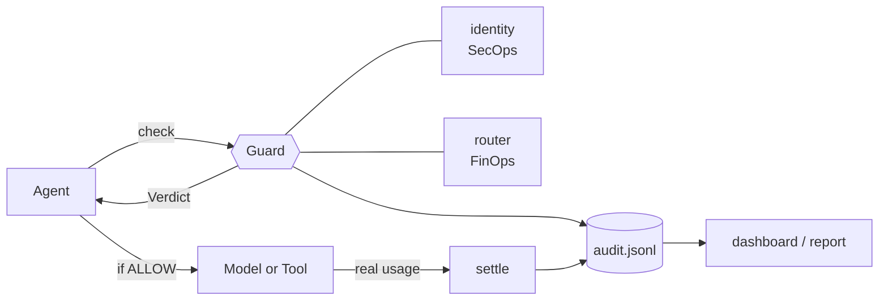

# 🛡️ tokenmaxxing-guard

**See an AI agent get blocked in 60 seconds.** *Unified FinOps + SecOps guardrails for autonomous agents. No API key needed.*

[](https://github.com/NehaAIML/tokenmaxxing-guard/actions/workflows/ci.yml)


[](LICENSE)


---

## 💸 The Problem

Agents burn tokens in loops, inherit broad service-account permissions, and the invoice arrives *after* the damage is done. FinOps watches the bill; SecOps watches the permissions; both are reading the same API logs in different languages, so a runaway agent looks like "a cost problem" to one team and "an access problem" to the other, and nobody owns it.

> *The invoice tells you what happened. This guard decides before it happens.*

---

## ⚡ The 60-Second Demo

```bash
git clone https://github.com/NehaAIML/tokenmaxxing-guard && cd tokenmaxxing-guard
./demo.sh
```

Three agents, three behaviours:

| Agent | Behaviour | Outcome |
|---|---|---|
| `code-review-bot` | Read-only, but keeps calling `write_file` with a 40k-token context | `BLOCK_SCOPE` x5, then **quarantined** |
| `summarizer-bot` | Well-behaved, cheap task | All `ALLOW`, routed to the small tier |
| `runaway-planner` | Allowed tools, loops on expensive calls | `ALLOW` x5, then `BLOCK_BUDGET` |

<!-- demo:start -->
```text
================================================================
TOKENMAXXING-GUARD | UNIFIED FINOPS + SECOPS DASHBOARD
================================================================

Agent   : code-review-bot
Status  : QUARANTINED
Spend   : $0.0000 of $5.00
Calls   : 0 allowed, 12 blocked (12 security, 0 budget)
Impact  : $2.5500 blocked  |  $0.0000 saved by routing

Agent   : summarizer-bot
Status  : OK
Spend   : $0.0105 of $2.00
Calls   : 10 allowed, 0 blocked (0 security, 0 budget)
Impact  : $0.0000 blocked  |  $0.5145 saved by routing

Agent   : runaway-planner
Status  : BUDGET_BLOCKED
Spend   : $1.0000 of $1.00
Calls   : 5 allowed, 3 blocked (0 security, 3 budget)
Impact  : $0.6000 blocked  |  $0.0000 saved by routing

----------------------------------------------------------------
TOTAL spent $1.0105 | blocked $3.1500 | routing saved $0.5145
Prices are illustrative. 'blocked' = what blocked calls WOULD have cost (counterfactual).
================================================================
```
<!-- demo:end -->

> This block is generated from the real code (`python scripts/update_readme.py`) and a test fails if it goes stale.

---

## 🏗️ Architecture



Every call runs one pipeline. The first failing check blocks it (**fail closed**), and *every* attempt, allowed or blocked, is written to the audit log:

`identity` → `quarantine` → `tool scope` → `context cap` → `rate limit` → `budget` → **ALLOW**

More: [docs/architecture.md](docs/architecture.md) (all diagrams and design decisions) · [docs/threat-model.md](docs/threat-model.md)

---

## 🔌 Use it in your agent

```python
from tokenmaxxing_guard import Guard, AuditLog

guard = Guard.from_policy("examples/policy.json", audit=AuditLog("audit.jsonl"))

verdict = guard.check("code-review-bot", task_type="summarize",
                      tool="read_file", input_tokens=8_000, output_tokens=500)
if not verdict.allowed:
    raise RuntimeError(f"{verdict.decision.value}: {verdict.reason}")   # fail closed

response = call_your_model(tier=verdict.tier, ...)                      # your SDK here
guard.settle(verdict.call_id, response.input_tokens, response.output_tokens)
```

Install with `pip install -e .`. A complete runnable example: [`examples/integrate.py`](examples/integrate.py).

## 🚦 Decision codes

| Code | Meaning | Who cares |
|---|---|---|
| `ALLOW` | Passed every check; cost reserved; tier chosen | both |
| `BLOCK_IDENTITY` | Agent ID is not registered | SecOps |
| `BLOCK_QUARANTINE` | Too many violations in the window; operator release needed | SecOps |
| `BLOCK_SCOPE` | Tool is outside the agent's least-privilege allow-list | SecOps |
| `BLOCK_CONTEXT` | Input exceeds the per-call token cap | FinOps + SecOps |
| `BLOCK_RATE` | Too many calls in the last 60 s | FinOps + SecOps |
| `BLOCK_BUDGET` | Projected spend would exceed the agent's budget | FinOps |

Quarantine counts out-of-scope calls in a **sliding window** (default: 5 in 10 minutes). Interleaving legal calls does not reset it. Real usage reported to `settle()` can raise an `OVERRUN` alert if it exceeds the budget.

## ⚙️ Configuration

One JSON file holds agents, prices and routing ([`examples/policy.json`](examples/policy.json)):

```json
{
  "models": { "small": {"input_per_mtok": 0.10, "output_per_mtok": 0.50},
              "frontier": {"input_per_mtok": 5.00, "output_per_mtok": 25.00} },
  "routes": { "summarize": "small", "architecture": "frontier" },
  "default_tier": "frontier",
  "agents": { "code-review-bot": { "allowed_tools": ["read_file"], "budget_usd": 5.00,
                                    "quarantine_after_denials": 5,
                                    "quarantine_window_seconds": 600 } }
}
```

> ⚠️ **Prices here are illustrative.** Load your provider's current price list before trusting any dollar figure. "Blocked" dollars are a counterfactual: what the blocked calls *would have* cost.

## 🖥️ CLI

```bash
tokenmaxxing-guard demo --log audit.jsonl     # run the scenario, keep the audit trail
tokenmaxxing-guard report audit.jsonl         # same dashboard, rebuilt from the log
tokenmaxxing-guard report audit.jsonl --json  # machine-readable, for FinOps / SIEM pipelines
```

## 🗂️ Project layout

```
src/tokenmaxxing_guard/   guard · identity · router · money · ledger · dashboard · policy · cli
tests/                    unit, regression, concurrency and README-sync tests
examples/                 policy.json · integrate.py
scripts/                  update_readme.py
docs/                     architecture.md · threat-model.md
.github/                  CI (Python 3.9-3.13) · issue/PR templates · dependabot
```

## ⚠️ Limitations (read before production)

A **reference implementation**, not a gateway. Single process and in-memory state; `agent_id` is trusted, not authenticated; the audit file is append-safe but not tamper-proof; prices are illustrative; money uses exact `Decimal` arithmetic but the *token estimates* it multiplies are only as good as your inputs. Details in the [threat model](docs/threat-model.md).

## 🗺️ Roadmap

- [ ] Shared state backend (Redis) for multi-process budgets
- [ ] Authenticated agent identity (signed tokens)
- [ ] Argument-level tool scopes (`write_file` only under `/tmp/`)
- [ ] Provider adapters (OpenAI / Anthropic / Bedrock) with real token accounting
- [ ] OpenTelemetry export, Prometheus metrics
- [ ] Hash-chained audit log for tamper evidence

## 🤝 Contributing, security, license

[CONTRIBUTING.md](CONTRIBUTING.md) · [SECURITY.md](SECURITY.md) · [CHANGELOG.md](CHANGELOG.md) · MIT, see [LICENSE](LICENSE)
