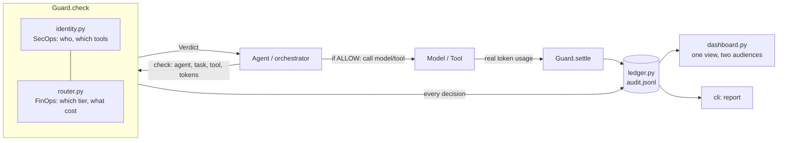
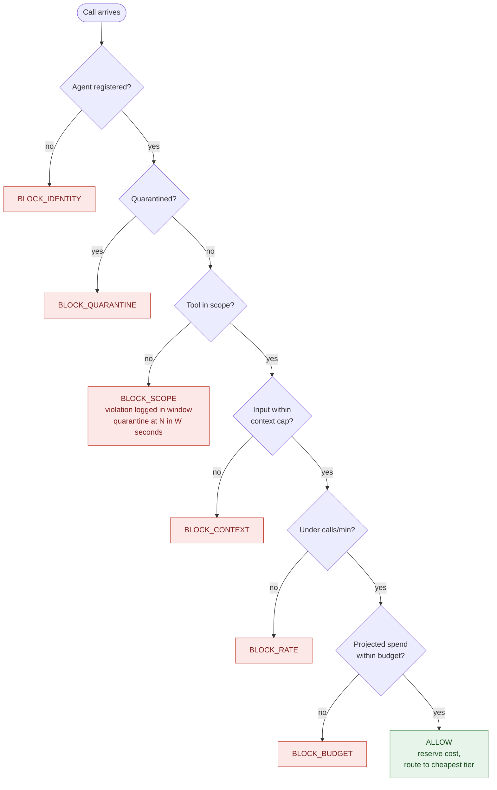
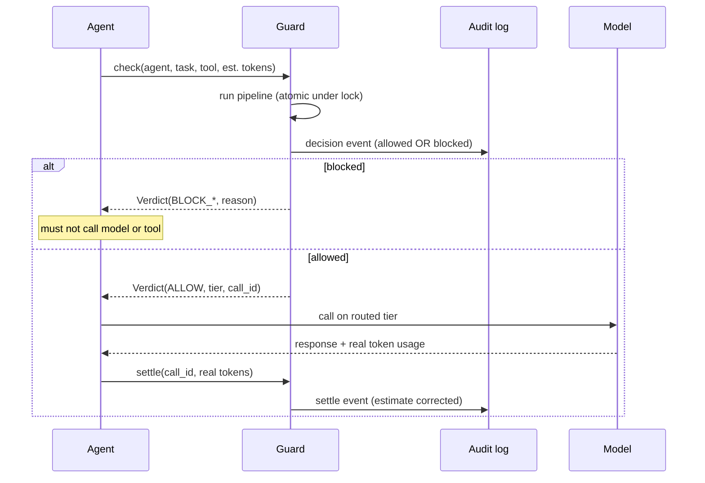

# Architecture

`tokenmaxxing-guard` puts **one control point** between an agent and anything that costs money or
has side effects. FinOps and SecOps are not two systems that get reconciled later; they are two
kinds of check in the same function, writing to the same audit log.

## Component view

## Decision pipeline

Checks run in a fixed order: most security-critical and cheapest first. The first failure wins,
the call is **blocked (fail closed)**, and the attempt is still written to the audit log.

## Call lifecycle

## Design decisions

| Decision | Why |
|---|---|
| **Fail closed.** Any non-`ALLOW` means do not proceed. | A guard that fails open is a suggestion. |
| **Log blocked calls, not just allowed ones.** | v0.1 only recorded allowed calls, so a blocked attack left the dashboard green. Blocked attempts *are* the security signal. |
| **Reserve at `check`, correct at `settle`.** | Estimates gate the call; real usage keeps the ledger honest. |
| **Atomic check-and-reserve under one lock.** | Without it, N concurrent calls can each pass the budget check and collectively overspend. |
| **Quarantine is automatic, release is manual.** | Repeated out-of-scope calls are an incident, not a retry loop. A human lifts it. |
| **Violations are counted in a sliding window, not a streak.** | A streak resets on every legal call, so alternating legal and illegal calls would never trip it (this was a real bug in 0.2.0). |
| **Money is `Decimal`, never `float`.** | Float sums drift (0.1 x 10 is not 1.0). A FinOps tool must be exact. |
| **`settle()` can only report an overrun, not prevent it.** | The call already happened. The guard raises `OVERRUN` and blocks the *next* call. |
| **Dashboard is computed from the audit log only.** | One source of truth. `report` on a log file gives the same answer as the live dashboard. |
| **Zero runtime dependencies.** | Drop-in anywhere; easy to audit a security tool. |

## Module map

| File | Responsibility |
|---|---|
| `guard.py` | The pipeline, `check()` and `settle()` |
| `identity.py` | Agent records, scopes, limits, thread-safe registry |
| `money.py` | Exact `Decimal` helpers |
| `router.py` | Task to tier mapping, cost math, routing-savings baseline |
| `ledger.py` | Append-only JSONL audit log |
| `dashboard.py` | `summarize()` and `render()` over audit events |
| `policy.py` | Load agents, prices, routes from JSON |
| `scenarios.py` / `cli.py` | Demo and `report` command |
